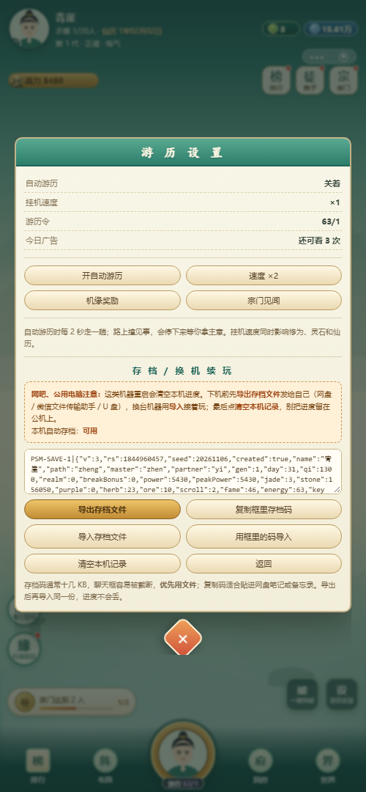

# 破山门 · 宗门模拟器

一个**纯前端、零依赖、单文件**的修仙宗门经营模拟器：开一间山门，招弟子、盖房子、派差事、路上撞见三选一事件，靠挂机涨修为，最后收山看结局。

> **打开即玩**：双击 `index.html`，或直接访问在线演示 👉 https://__USER__.github.io/pomen-sect-simulator/
>
> 不联网、不安装、不登录、不加载任何外部图片或脚本 —— 全部画面都是代码画出来的。



---

## 一、项目定位

这不是一个「点按钮加数字」的放置游戏壳子，而是一次**同一份逻辑内核驱动两套 UI**的工程实践：

- 内核是一份**零 DOM 依赖**的纯逻辑层（状态机 + 数值系统 + 事件池 + 存档序列化）；
- 外面套两层壳：一层是微信小程序页面，一层是单文件 HTML（本仓库）。
- 所以同一个存档、同一套数值、同一批事件，在两端表现完全一致。

界面架构参考了同类产品（竖屏挂机主界面、事件金卡、弟子属性雷达与八格装备、修行日志、七日签到、排行榜）的**信息布局**，但人物、事件、台词、数值、头像与山水全部为自绘自写，未使用任何既有作品的美术资源与专有名词。

**本仓库收录网页版**（可直接运行的单文件构建）。完整工程另含小程序端与回归测试套件，未在此仓库展开；网页版的逻辑内核与小程序端同源。

---

## 二、玩法

| 系统 | 说明 |
| --- | --- |
| 宗门开局 | 填宗门名，选路数（剑/丹/符…）、长老、道侣，不同组合影响成长曲线 |
| 游历 | 中央大圆点一次推进 15 天，途中触发三选一事件（收益 / 风险 / 隐藏） |
| 弟子养成 | 招募、属性雷达（根骨/悟性/心性/机缘…）、八格装备、差事派遣 |
| 建筑 | 11 种建筑，各自产出不同资源，升级解锁新差事 |
| 差事 | 8 类差事，按弟子属性结算产出与事件概率 |
| 宗门战 | 与其他宗门比试，胜负影响声望与资源 |
| 签到 / 机缘 / 突破 | 七日签到、随机机缘、一键突破 |
| 离线收益 | 关闭页面期间按离线时长结算，回来补发 |
| 结局统计 | 收山时按弟子数、建筑等级、声望、事件收集度给出结局评级 |

---

## 三、技术要点

**1. 逻辑与渲染彻底分离**
内核不碰 `document`、不碰 `wx`，只暴露「输入意图 → 输出状态快照」。网页壳订阅快照做差异渲染，小程序壳 `setData`。换端只换壳，不动内核。

**2. 单文件分发**
整个游戏打包成一个 HTML（约 220 KB），CSS 与 JS 内联，图形用 SVG/Canvas 现画。好处是分发成本为零：一个文件发给任何人、丢进任何静态托管都能跑，适合网吧/公用电脑这种「不能装东西」的场景。

**3. 存档的三层兜底**
网吧有还原卡，浏览器 `localStorage` 重启即清空，所以做了三层：
- 自动存档（本机 `localStorage`，正常情况）
- **导出 / 导入存档文件**（`.txt`，明文 JSON，带版本号校验）
- **复制 / 粘贴存档码**（禁止下载文件时的降级通道）

导入时校验存档魔数与版本号，不匹配明确报错而不是静默损坏。

**4. 数值全部可配**
事件、建筑、差事、结局阈值集中在配置表里，调平衡不用改逻辑。

---

## 四、本地运行

```bash
# 方式一：直接双击 index.html
# 方式二：起个静态服务器（避免个别浏览器的 file:// 限制）
python -m http.server 8000
# 打开 http://localhost:8000
```

无构建步骤、无依赖安装、无 Node 版本要求。

---

## 五、目录结构

```
.
├── index.html                     # 游戏本体（单文件，双击即玩）
├── assets/save-panel.png          # 存档面板截图
├── docs/
│   ├── 项目简介.txt                # 项目概述
│   └── 网吧离线包操作流程.txt       # 公用电脑上机/存档/换机完整流程与排错
└── CHECKSUM.txt                   # 文件大小与 SHA-256，用于校验完整性
```

---

## 六、已知取舍

- 单文件意味着**没有模块拆分**：为了「一个文件就能跑」，内核和壳被打进同一个 HTML，阅读时需要按注释分区找。这是分发便利性换来的代价。
- 存档是明文 JSON，允许玩家自己改（改坏了读不回来，不影响他人）。游戏没有联网校验，也不打算有。
- 离线收益按本地时间计算，改系统时间可以刷——单机游戏，不做防作弊。

---

## 七、License

MIT
